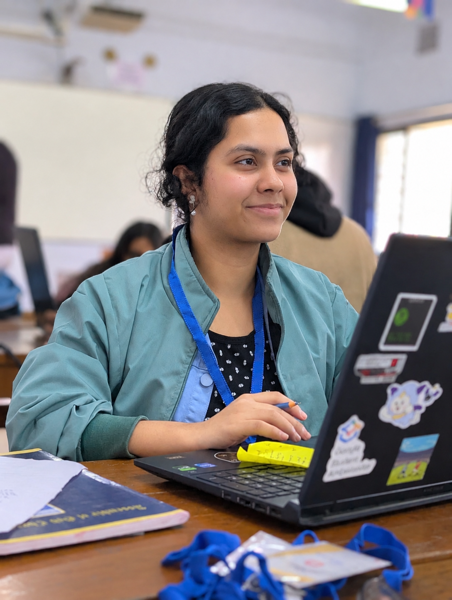

# Srinjoyee Dey // Creative Developer & AI Systems Portfolio

A visual-forward, high-performance portfolio showcasing full-stack engineering, 3D interactive web experiences, and artificial intelligence architectures.



---

## ⚡ Quick Start (Run Locally)

This portfolio is pre-bundled and works out-of-the-box with zero build step required.

### Option 1: Using Node & Local Server (Recommended)
```bash
# 1. Clone the repository
git clone https://github.com/SrinjoyeeDey/Portfolio-Final.git
cd Portfolio-Final

# 2. Install dependencies
npm install

# 3. Start local development server
npm run dev
# or: npm start
```
Open [http://localhost:3000](http://localhost:3000) (or the port shown in terminal) to view the live experience.

### Option 2: Direct Static / VS Code Live Server
You can open `index.html` directly using VS Code Live Server or any static web server (e.g. `python3 -m http.server 8000`). All modular WebGL, Three.js, and React Bits bundles are pre-compiled in root.

---

## 🛠️ Building From Source

All interactive 3D and React Bits components live in `src/` and compile directly to lightweight standalone bundles:

```bash
# Build all bundles (Lanyard, Showcase, MemoryWall, TargetCursor, TechText, etc.)
npm run build
```

Individual sub-bundle commands:
- `npm run build:projects-showcase` — Projects Selected Works deck
- `npm run build:memory-wall` — Snapshots 3D Spatial DriftWall
- `npm run build:target-cursor` — Custom responsive target cursor
- `npm run build:tech-text` — Interactive Matrix TechText scrambler
- `npm run build:circular-text` — Circular SVG rotating badge

---

## 🌟 Key Architecture & Features

- **Editorial Spotlight**: Full-bleed monochrome-to-color cursor torch reveal, calibrated contrast overlay, and camera viewport metadata.
- **Hero 3D Studio**: Real-time Three.js 3D character model with studio hemisphere & directional lighting, soft ground contact shadow, and mouse/touch drag rotation.
- **Selected Works Deck**: Interactive 3D layered stack showcase with audio feedback, keyboard arrow navigation, and live project modals.
- **Snapshots & Memories**: 3D Spatial DriftWall featuring authentic photographs from national hackathons, award ceremonies, and campus engineering sprints.
- **Interactive CLI Terminal**: Functional developer terminal with humorous, sarcastic commands (`about`, `skills`, `projects`, `roast`, `sudo`, `hack`, `coffee`, `joke`, `tea`) and one-click quick action chips.
- **Mimo AI Companion**: Interactive portfolio assistant with quick action pills, in-bubble action chips, and emoji feedback reactions.
- **3D World Globe & Frosted Glass**: Interactive WebGL Cobe globe with translucent frosted glass backdrop lens (`backdrop-filter: blur(28px)`), orbital ring, and live telemetry chip.
- **Lenis Inertial Scrolling**: Ultra-smooth 60/120fps scrolling synced directly to GSAP ScrollTrigger ticker.

---

## 📂 Project Structure

```
├── index.html                 # Main entry application markup
├── styles.css                 # Master design system & responsive styling
├── script.js                  # Main controller, Lenis, Terminal & Mimo chatbot
├── editorial-spotlight.css/js # Editorial Spotlight section styling & logic
├── memory-wall.css            # Memory Wall & DriftWall styling
├── src/                       # Source JSX components (React / Three.js / WebGL)
│   ├── DriftWall.jsx          # 3D spatial drift canvas & track animator
│   ├── memory-wall-entry.jsx  # Memory Wall entry point with real photo catalog
│   ├── ProjectsShowcase.jsx   # Selected Works card stack component
│   └── globe-entry.js         # Cobe 3D Globe initialization & markers
├── scripts/                   # Esbuild compilation scripts for bundles
├── images/                    # Visual assets & authentic hackathon photos
│   └── grid_img/              # Real hackathon & campus victory photographs
└── lib/                       # External libraries (Lenis smooth scroll engine)
```

---

## 🚀 Deployment

Deployable instantly to any static hosting provider:
- **Vercel**: Import repository and deploy (root directory, no framework override needed).
- **GitHub Pages**: Go to Repo Settings > Pages > Deploy from branch `main` / `root`.
- **Netlify / Cloudflare Pages**: Connect repo, set publish directory to `.`.

---

## 📬 Contact & Connect

- **Engineer**: Srinjoyee Dey
- **Email**: [deysrinjoyee04@gmail.com](mailto:deysrinjoyee04@gmail.com)
- **LinkedIn**: [linkedin.com/in/srinjoyee-dey](https://linkedin.com/in/srinjoyee-dey)
- **GitHub**: [github.com/SrinjoyeeDey](https://github.com/SrinjoyeeDey)
